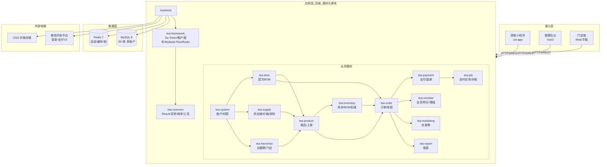

# 茶饮 SaaS 系统数据库详细设计

> 版本：v1.1 ｜ 关联文档：`茶饮SaaS项目规划书.md`（v1.1）、`茶饮SaaS-PRD.md`（v1.1）、`茶饮SaaS-需求评审报告.md`（v1.0）｜ 状态：已评审待开发
> 本文档定义全部核心表结构，是 M2 地基搭建与各业务模块开发的直接输入。表编号对应 PRD 功能编号（F-XXX）与 Maven 模块。
>
> **v1.1 变更说明**：依据 PRD v1.1 决策同步——新增 `sys_package`（套餐表）、`pay_callback_task`（回调重试表）；`ord_order` 增加 `order_source`（订单来源：小程序/门店收银）；`pay_payment.channel` 扩展储值通道；`pay_refund` 明确整单退款规则字段。

---

## 0. 系统架构图（Mermaid）

> 完整可视化架构图见 `prototype/architecture.html`（浏览器打开）。此处为文字版，供文档内引用。



**模块依赖方向**：`common → framework → system → {bom, franchise, supply} → {product, inventory} → {order, payment, member, marketing, report} → server`

---

## 目录

1. [设计规范](#1-设计规范)
2. [ER 关系总览](#2-er-关系总览)
3. [平台与系统表（tea-system）](#3-平台与系统表tea-system)
4. [加盟商与门店表（tea-franchise）](#4-加盟商与门店表tea-franchise)
5. [配方 BOM 表（tea-bom）](#5-配方-bom-表tea-bom)
6. [商品与上架表（tea-product）](#6-商品与上架表tea-product)
7. [供应链表（tea-supply）](#7-供应链表tea-supply)
8. [库存表（tea-inventory）](#8-库存表tea-inventory)
9. [订单与支付表（tea-order / tea-payment）](#9-订单与支付表tea-order--tea-payment)
10. [会员表（tea-member）](#10-会员表tea-member)
11. [营销表（tea-marketing）](#11-营销表tea-marketing)
12. [关键索引与约束](#12-关键索引与约束)
13. [库存一致性设计（SQL 级）](#13-库存一致性设计sql-级)
14. [多租户实现要点](#14-多租户实现要点)
15. [建表顺序与初始化数据](#15-建表顺序与初始化数据)

---

## 1. 设计规范

### 1.1 通用约定

| 约定 | 规则 |
|---|---|
| 主键 | `id BIGINT`，雪花算法生成，不依赖自增 |
| 租户 | 所有业务表含 `tenant_id BIGINT NOT NULL`；平台超级租户 = `0` |
| 审计 | `create_by BIGINT`、`create_time DATETIME`、`update_by BIGINT`、`update_time DATETIME` |
| 逻辑删除 | `del_flag TINYINT NOT NULL DEFAULT 0`（0 正常 / 1 已删）；唯一索引必须携带 del_flag |
| 金额 | 统一存**分**（整数）：单价 `INT`，总额 `BIGINT` |
| 原料数量 | `DECIMAL(10,3)`（克/kg/个混用，保留 3 位小数） |
| 状态字段 | `TINYINT` + 注释说明状态含义，禁止魔法值裸奔 |
| 命名 | 小写下划线；表名前缀 = 所属模块（`sys_`/`fra_`/`bom_`/`prd_`/`sup_`/`inv_`/`ord_`/`pay_`/`mem_`/`mkt_`） |
| 引擎/字符集 | InnoDB，utf8mb4，utf8mb4_general_ci |
| 关联 | 外键不建物理约束（由应用层保证），仅建索引；避免连锁删除 |

### 1.2 通用字段说明（下文表中省略，默认存在）

每张业务表默认包含：`id`、`tenant_id`、`create_by`、`create_time`、`update_by`、`update_time`、`del_flag`。下文"字段"列只列业务字段 + 关键约束字段。

---

## 2. ER 关系总览

```
tenant（品牌租户）
 ├─ sys_user（员工）──┬─ sys_user_role ── sys_role ── sys_role_menu ── sys_menu
 │                    └─ sys_user_store ── store（门店）──┬─ inv_store_material_stock
 ├─ franchisee（加盟商）─< store（1:N，store.franchisee_id 可空=直营）
 ├─ material（原料）───< bom_formula_item ── bom_formula ──< prd_product
 ├─ supplier（供应商）──< tier_price（原料×等级×价格）
 ├─ store ──< prd_listing ── prd_product（门店上架）
 ├─ store ──< sup_purchase_order ── sup_purchase_order_item ── material
 ├─ store ──< inv_store_material_stock ──< inv_stock_log
 ├─ store ──< ord_order ── ord_order_item ── prd_product
 ├─ store ──< pay_payment / pay_refund
 ├─ member（顾客）──< ord_order / mem_points_log / mem_recharge_record / mkt_coupon
 └─ mkt_coupon_template ──< mkt_coupon
```

**核心关系说明**
- 商品可售判断：`inv_store_material_stock.stock_qty >= Σ(bom_formula_item.qty × 购买数量)`（按 store_id + 商品配方）
- 采购计价：`sup_purchase_order_item.unit_price` 由 `tier_price`（material_id × 加盟商等级）写入快照
- 订单扣库存：`ord_order_item` 携带 `formula_id` 快照，扣减按快照执行（防配方修改影响历史单）

---

## 3. 平台与系统表（tea-system）

### 3.1 `tenant` 品牌租户表（F-SYS-01）

| 字段 | 类型 | 允许空 | 说明 |
|---|---|---|---|
| tenant_code | VARCHAR(32) | N | 租户编码，唯一 |
| tenant_name | VARCHAR(64) | N | 品牌名称 |
| contact_name | VARCHAR(32) | Y | 联系人 |
| contact_phone | VARCHAR(20) | Y | 联系电话 |
| package_code | VARCHAR(32) | Y | 套餐编码（关联 sys_package） |
| store_limit | INT | N 默认 0 | 门店数上限（0=不限，冗余自套餐） |
| status | TINYINT | N | 1 启用 / 0 停用 |
| expire_time | DATETIME | Y | 到期时间 |

> 唯一索引：`uk_tenant_code(tenant_code, del_flag)`

### 3.1a `sys_package` 套餐表（F-SYS-01，v1.1 新增）

| 字段 | 类型 | 允许空 | 说明 |
|---|---|---|---|
| package_code | VARCHAR(32) | N | 套餐编码，唯一 |
| package_name | VARCHAR(32) | N | 套餐名（基础版/专业版/旗舰版） |
| price_per_store | INT | N | 单价（分/店/月）：99/199/299 元 |
| store_limit | INT | N | 门店数上限 |
| feature_json | JSON | N | 功能开关（如营销/报表深度/高级数据） |
| status | TINYINT | N | 1 启用 / 0 停用 |

> 唯一索引：`uk_package_code(package_code)`

### 3.2 `sys_user` 用户表（F-SYS-02）

| 字段 | 类型 | 允许空 | 说明 |
|---|---|---|---|
| username | VARCHAR(32) | N | 登录名 |
| password | VARCHAR(128) | N | BCrypt 密文 |
| nickname | VARCHAR(32) | Y | 昵称 |
| phone | VARCHAR(20) | Y | 手机号 |
| status | TINYINT | N | 1 启用 / 0 禁用 |
| user_type | TINYINT | N | 0 平台 / 1 总部 / 2 加盟商 / 3 门店 |

> 唯一索引：`uk_username(tenant_id, username, del_flag)`；平台管理员 `tenant_id = 0`

### 3.3 `sys_role` 角色表（F-SYS-02）

| 字段 | 类型 | 允许空 | 说明 |
|---|---|---|---|
| role_name | VARCHAR(32) | N | 角色名（如"总部-供应链"） |
| role_code | VARCHAR(32) | N | 角色编码（R1–R8 预置） |
| data_scope | TINYINT | N | 1 全部品牌 / 2 本租户 / 3 名下门店 / 4 本店 |
| remark | VARCHAR(255) | Y | 备注 |

> 唯一索引：`uk_role(tenant_id, role_code, del_flag)`

### 3.4 `sys_user_role` 用户角色关联（F-SYS-02）

| 字段 | 类型 | 说明 |
|---|---|---|
| user_id | BIGINT | 用户 ID |
| role_id | BIGINT | 角色 ID |

> 唯一索引：`uk_user_role(user_id, role_id)`；一个用户可多角色（取权限并集）

### 3.5 `sys_menu` 菜单/按钮表（F-SYS-02）

| 字段 | 类型 | 允许空 | 说明 |
|---|---|---|---|
| parent_id | BIGINT | N | 父菜单 ID（0=根） |
| menu_name | VARCHAR(32) | N | 名称 |
| menu_type | TINYINT | N | 1 目录 / 2 菜单 / 3 按钮 |
| path | VARCHAR(128) | Y | 前端路由路径 |
| component | VARCHAR(128) | Y | 前端组件路径 |
| perm | VARCHAR(64) | Y | 权限码（如 `bom:edit`、`purchase:ship`，来自 PRD 5.3） |
| sort | INT | N | 排序 |
| visible | TINYINT | N | 1 显示 / 0 隐藏 |
| status | TINYINT | N | 1 启用 / 0 停用 |

> `tenant_id` 存 `0`（平台内置菜单），全租户共用

### 3.6 `sys_role_menu` 角色菜单关联

| 字段 | 类型 | 说明 |
|---|---|---|
| role_id | BIGINT | 角色 ID |
| menu_id | BIGINT | 菜单 ID |

> 唯一索引：`uk_role_menu(role_id, menu_id)`

### 3.7 `sys_user_store` 用户门店绑定（一人多店）

| 字段 | 类型 | 说明 |
|---|---|---|
| user_id | BIGINT | 用户 ID |
| store_id | BIGINT | 门店 ID |
| is_default | TINYINT | 1 默认门店 / 0 否 |

> 唯一索引：`uk_user_store(user_id, store_id)`；数据权限"名下门店/本店"依据此表

### 3.8 `sys_operation_log` 操作日志表（F-SYS-04）

| 字段 | 类型 | 允许空 | 说明 |
|---|---|---|---|
| user_id | BIGINT | Y | 操作人 |
| module | VARCHAR(32) | Y | 模块（order/purchase/bom…） |
| action | VARCHAR(32) | Y | 动作描述 |
| method | VARCHAR(128) | Y | 接口方法 |
| params | JSON | Y | 请求参数（脱敏后） |
| ip | VARCHAR(64) | Y | 来源 IP |
| cost_ms | INT | Y | 耗时 |
| status | TINYINT | N | 1 成功 / 0 失败 |

---

## 4. 加盟商与门店表（tea-franchise）

### 4.1 `fra_franchisee` 加盟商表（F-FRA-01）

| 字段 | 类型 | 允许空 | 说明 |
|---|---|---|---|
| franchisee_code | VARCHAR(32) | N | 加盟商编号，唯一 |
| franchisee_name | VARCHAR(64) | N | 名称 |
| contact_name | VARCHAR(32) | Y | 联系人 |
| contact_phone | VARCHAR(20) | Y | 电话 |
| level_code | VARCHAR(8) | N | 等级 A/B/C（一期人工评定，F-FRA-01） |
| join_date | DATE | Y | 加盟日期 |
| status | TINYINT | N | 1 合作中 / 0 已终止 |

> 索引：`idx_store_franchisee(tenant_id, franchisee_id)`；等级用于 `tier_price` 取价

### 4.2 `fra_store` 门店表（F-FRA-02 / F-APP-01）

| 字段 | 类型 | 允许空 | 说明 |
|---|---|---|---|
| store_code | VARCHAR(32) | N | 门店编号，唯一 |
| store_name | VARCHAR(64) | N | 门店名称 |
| franchisee_id | BIGINT | Y | 所属加盟商（NULL=总部直营） |
| address | VARCHAR(255) | Y | 地址 |
| longitude | DECIMAL(10,6) | Y | 经度（最近门店用） |
| latitude | DECIMAL(10,6) | Y | 纬度 |
| business_status | TINYINT | N | 1 营业 / 0 打烊（顾客端不可下单） |
| open_time | TIME | Y | 营业开始 |
| close_time | TIME | Y | 营业结束 |
| status | TINYINT | N | 1 启用 / 0 停用 |

> 索引：`idx_store_tenant(tenant_id, del_flag)`；`idx_store_fra(tenant_id, franchisee_id)`

---

## 5. 配方 BOM 表（tea-bom）

### 5.1 `bom_material` 原料档案表（F-BOM-01）

| 字段 | 类型 | 允许空 | 说明 |
|---|---|---|---|
| material_code | VARCHAR(32) | N | 原料编码，唯一 |
| material_name | VARCHAR(64) | N | 原料名称（红茶、珍珠、杯盖…） |
| category | VARCHAR(32) | Y | 分类（茶底/小料/包材/奶制品） |
| unit | VARCHAR(8) | N | 单位（g/kg/个/杯） |
| warn_threshold | DECIMAL(10,3) | Y | 库存预警阈值（F-INV-03） |
| cost_price | INT | Y | 参考成本价（分/单位） |
| status | TINYINT | N | 1 启用 / 0 停用 |

> 唯一索引：`uk_material(tenant_id, material_code, del_flag)`

### 5.2 `bom_formula` 配方表（F-BOM-02）

| 字段 | 类型 | 允许空 | 说明 |
|---|---|---|---|
| formula_code | VARCHAR(32) | N | 配方编码，唯一 |
| formula_name | VARCHAR(64) | N | 配方名称（珍珠奶茶） |
| version | INT | N | 版本号（修改 +1） |
| cost_total | INT | Y | 试算总成本（分/杯，F-BOM-03） |
| status | TINYINT | N | 1 启用 / 0 停用 |

> 唯一索引：`uk_formula(tenant_id, formula_code, del_flag)`

### 5.3 `bom_formula_item` 配方明细表（F-BOM-02）

| 字段 | 类型 | 允许空 | 说明 |
|---|---|---|---|
| formula_id | BIGINT | N | 配方 ID |
| material_id | BIGINT | N | 原料 ID |
| qty | DECIMAL(10,3) | N | 用量（如红茶 20.000 g） |
| sort | INT | N | 排序 |

> 索引：`idx_formula_item(formula_id)`；唯一索引：`uk_formula_material(formula_id, material_id)`（一原料一行）

---

## 6. 商品与上架表（tea-product）

### 6.1 `prd_category` 商品分类表（F-PRD-01）

| 字段 | 类型 | 说明 |
|---|---|---|
| category_name | VARCHAR(32) | 分类名（招牌/鲜果茶/奶茶/小食） |
| parent_id | BIGINT | 父分类（0=根） |
| sort | INT | 排序 |

### 6.2 `prd_product` 商品表（F-PRD-01）

| 字段 | 类型 | 允许空 | 说明 |
|---|---|---|---|
| category_id | BIGINT | Y | 分类 |
| product_code | VARCHAR(32) | N | 商品编码 |
| product_name | VARCHAR(64) | N | 商品名 |
| formula_id | BIGINT | N | 配方 ID（引用 bom_formula） |
| suggest_price | INT | N | 建议售价（分） |
| image | VARCHAR(255) | Y | 图片 |
| description | VARCHAR(255) | Y | 描述 |
| publish_status | TINYINT | N | 1 已发布（进产品库）/ 0 草稿 |
| status | TINYINT | N | 1 启用 / 0 停用 |

> 唯一索引：`uk_product(tenant_id, product_code, del_flag)`；索引：`idx_product_category(tenant_id, category_id)`

### 6.3 `prd_product_spec` 规格组表（F-PRD-01）

| 字段 | 类型 | 说明 |
|---|---|---|
| product_id | BIGINT | 商品 ID |
| spec_name | VARCHAR(16) | 规格组（温度/糖度） |
| is_required | TINYINT | 1 必选 / 0 可选 |
| sort | INT | 排序 |

### 6.4 `prd_product_spec_option` 规格选项表

| 字段 | 类型 | 说明 |
|---|---|---|
| spec_id | BIGINT | 规格组 ID |
| option_name | VARCHAR(16) | 选项（去冰/半糖） |
| extra_price | INT | 加价（分，默认 0） |
| sort | INT | 排序 |

### 6.5 `prd_listing` 门店上架表（F-PRD-02 / F-ORD-01）

| 字段 | 类型 | 允许空 | 说明 |
|---|---|---|---|
| store_id | BIGINT | N | 门店 ID |
| product_id | BIGINT | N | 商品 ID |
| sale_price | INT | N | 本店售价（分，可调，上限配置） |
| sort | INT | N | 排序 |
| status | TINYINT | N | 1 上架 / 0 下架 |

> 唯一索引：`uk_listing(tenant_id, store_id, product_id, del_flag)`；索引：`idx_listing_store(tenant_id, store_id, status)`
> 说明：**可售状态不存列**，由库存实时判定（见第 13 章）；如需列表性能，二期加缓存列 `sellable_flag` 由库存事件刷新

---

## 7. 供应链表（tea-supply）

### 7.1 `sup_supplier` 供应商表（F-SUP-01）

| 字段 | 类型 | 允许空 | 说明 |
|---|---|---|---|
| supplier_code | VARCHAR(32) | N | 供应商编码 |
| supplier_name | VARCHAR(64) | N | 名称 |
| contact_name | VARCHAR(32) | Y | 联系人 |
| contact_phone | VARCHAR(20) | Y | 电话 |
| payment_terms | VARCHAR(64) | Y | 账期说明 |
| status | TINYINT | N | 1 合作 / 0 停用 |

### 7.2 `sup_supplier_material` 供应商-原料供应关系（F-SUP-01）

| 字段 | 类型 | 说明 |
|---|---|---|
| supplier_id | BIGINT | 供应商 ID |
| material_id | BIGINT | 原料 ID |
| supply_price | INT | 参考供货价（分/单位） |

> 唯一索引：`uk_sup_material(supplier_id, material_id)`

### 7.3 `sup_tier_price` 分级价格表（F-SUP-02）

| 字段 | 类型 | 说明 |
|---|---|---|
| material_id | BIGINT | 原料 ID |
| level_code | VARCHAR(8) | 加盟商等级（A/B/C） |
| price | INT | 单价（分/单位） |

> 唯一索引：`uk_tier_price(tenant_id, material_id, level_code)`；采购单按"加盟商等级"自动取价

### 7.4 `sup_purchase_order` 采购单表（F-SUP-03）

| 字段 | 类型 | 允许空 | 说明 |
|---|---|---|---|
| order_no | VARCHAR(32) | N | 采购单号，唯一 |
| store_id | BIGINT | N | 门店 ID |
| franchisee_id | BIGINT | Y | 加盟商 ID（快照冗余） |
| level_code | VARCHAR(8) | Y | 计价等级（下单时快照） |
| status | TINYINT | N | 1 待确认 / 2 已确认 / 3 已发货 / 4 已入库 / 5 已取消 |
| total_amount | BIGINT | N | 总额（分） |
| confirm_by | BIGINT | Y | 确认人（总部） |
| ship_by | BIGINT | Y | 发货人 |
| receive_by | BIGINT | Y | 收货人 |
| confirm_time | DATETIME | Y | 确认时间 |
| ship_time | DATETIME | Y | 发货时间 |
| receive_time | DATETIME | Y | 入库时间 |
| remark | VARCHAR(255) | Y | 备注 |

> 唯一索引：`uk_purchase_no(tenant_id, order_no)`；索引：`idx_purchase_store(tenant_id, store_id, status)`

### 7.5 `sup_purchase_order_item` 采购单明细表（F-SUP-03）

| 字段 | 类型 | 说明 |
|---|---|---|
| order_id | BIGINT | 采购单 ID |
| material_id | BIGINT | 原料 ID |
| qty | DECIMAL(10,3) | 数量 |
| unit_price | INT | 成交单价（分，确认时按 tier_price 写入**快照**） |
| amount | BIGINT | 小计（分） |

> 索引：`idx_purchase_item(order_id)`

---

## 8. 库存表（tea-inventory）

### 8.1 `inv_store_material_stock` 门店原料库存表（F-INV-01 / F-INV-02）

| 字段 | 类型 | 允许空 | 说明 |
|---|---|---|---|
| store_id | BIGINT | N | 门店 ID |
| material_id | BIGINT | N | 原料 ID |
| stock_qty | DECIMAL(10,3) | N | 当前库存（禁止为负，见 13 章） |
| version | INT | N | 乐观锁版本号 |

> 唯一索引：`uk_stock(tenant_id, store_id, material_id)`；索引：`idx_stock_material(tenant_id, material_id)`（总部库存统计用）

### 8.2 `inv_stock_log` 库存变动流水表（F-INV-02）

| 字段 | 类型 | 允许空 | 说明 |
|---|---|---|---|
| store_id | BIGINT | N | 门店 ID |
| material_id | BIGINT | N | 原料 ID |
| change_qty | DECIMAL(10,3) | N | 变动量（入为正/出为负） |
| before_qty | DECIMAL(10,3) | N | 变动前 |
| after_qty | DECIMAL(10,3) | N | 变动后 |
| biz_type | TINYINT | N | 1 下单扣减 / 2 超时回补 / 3 退款回补 / 4 采购入库 / 5 盘点修正 |
| biz_no | VARCHAR(32) | Y | 关联单号（订单号/采购单号） |
| remark | VARCHAR(128) | Y | 备注 |

> 索引：`idx_stock_log(tenant_id, store_id, biz_type)`、`idx_stock_log_biz(tenant_id, biz_no)`

---

## 9. 订单与支付表（tea-order / tea-payment）

### 9.1 `ord_order` 订单表（F-ORD-01 / F-ORD-02）

| 字段 | 类型 | 允许空 | 说明 |
|---|---|---|---|
| order_no | VARCHAR(32) | N | 订单号（雪花，唯一） |
| store_id | BIGINT | N | 门店 ID |
| member_id | BIGINT | Y | 顾客 ID（门店手工收银可空） |
| order_source | TINYINT | N | 1 小程序 / 2 门店收银（F-ORD-04，v1.1） |
| status | TINYINT | N | 1 待支付 / 2 已支付 / 3 制作中 / 4 待取餐 / 5 已完成 / 6 已取消 / 7 已退款 |
| total_amount | BIGINT | N | 商品总额（分） |
| discount_amount | BIGINT | N | 优惠合计（券+积分，分） |
| pay_amount | BIGINT | N | 实付金额（分） |
| coupon_id | BIGINT | Y | 使用的用户券 ID |
| coupon_amount | BIGINT | Y | 券抵扣（分） |
| points_used | INT | Y | 使用积分 |
| points_amount | BIGINT | Y | 积分抵扣（分） |
| balance_amount | BIGINT | Y | 储值支付金额（分） |
| pay_channel | TINYINT | N | 1 微信支付 |
| take_code | VARCHAR(8) | Y | 取餐码（3–4 位） |
| pay_time | DATETIME | Y | 支付时间 |
| finish_time | DATETIME | Y | 完成时间 |
| cancel_reason | VARCHAR(128) | Y | 取消原因 |
| remark | VARCHAR(255) | Y | 备注 |

> 唯一索引：`uk_order_no(tenant_id, order_no)`；索引：`idx_order_store(tenant_id, store_id, status, create_time)`、`idx_order_member(tenant_id, member_id)`

### 9.2 `ord_order_item` 订单明细表（F-ORD-01）

| 字段 | 类型 | 允许空 | 说明 |
|---|---|---|---|
| order_id | BIGINT | N | 订单 ID |
| product_id | BIGINT | N | 商品 ID |
| listing_id | BIGINT | Y | 上架记录 ID（快照冗余） |
| product_name | VARCHAR(64) | N | 商品名（快照） |
| spec_desc | VARCHAR(64) | Y | 规格描述（"去冰/半糖"快照） |
| price | INT | N | 成交单价（分） |
| qty | INT | N | 数量 |
| amount | BIGINT | N | 小计（分） |
| formula_id | BIGINT | N | 配方 ID（**扣库存快照**，防配方修改影响历史） |

> 索引：`idx_order_item(order_id)`

### 9.3 `pay_payment` 支付流水表（F-PAY-01）

| 字段 | 类型 | 允许空 | 说明 |
|---|---|---|---|
| payment_no | VARCHAR(32) | N | 支付单号，唯一 |
| order_id | BIGINT | N | 订单 ID |
| channel | TINYINT | N | 1 微信支付 / 2 储值（v1.1 双通道不同时用） |
| amount | BIGINT | N | 金额（分） |
| status | TINYINT | N | 1 待支付 / 2 成功 / 3 失败 / 4 已关闭 |
| transaction_id | VARCHAR(64) | Y | 微信交易号（储值通道为空） |
| callback_time | DATETIME | Y | 回调时间 |

> 唯一索引：`uk_payment_no(tenant_id, payment_no)`；索引：`idx_payment_order(tenant_id, order_id)`；回调幂等：`uk_transaction(tenant_id, transaction_id)`（可空）

### 9.4 `pay_refund` 退款流水表（F-PAY-02）

| 字段 | 类型 | 允许空 | 说明 |
|---|---|---|---|
| refund_no | VARCHAR(32) | N | 退款单号，唯一 |
| order_id | BIGINT | N | 订单 ID |
| payment_id | BIGINT | N | 支付流水 ID |
| amount | BIGINT | N | 退款金额（分，整单退=实付金额） |
| refund_type | TINYINT | N | 1 微信原路退回 / 2 退回储值账户（v1.1） |
| coupon_returned | TINYINT | N | 券是否退还（v1.1 决策：已核销券不退还=0） |
| reason | VARCHAR(128) | Y | 原因 |
| status | TINYINT | N | 1 处理中 / 2 成功 / 3 失败 |
| refund_time | DATETIME | Y | 成功时间 |

### 9.5 `pay_callback_task` 支付回调任务表（F-PAY-01，v1.1 新增）

| 字段 | 类型 | 允许空 | 说明 |
|---|---|---|---|
| task_no | VARCHAR(32) | N | 任务号，唯一 |
| biz_type | TINYINT | N | 1 支付回调 / 2 退款回调 |
| biz_no | VARCHAR(32) | N | 关联单号（payment_no/refund_no） |
| payload | JSON | N | 回调原始报文（脱敏） |
| retry_count | INT | N | 已重试次数 |
| max_retry | INT | N | 最大重试次数（默认 5） |
| status | TINYINT | N | 1 待处理 / 2 成功 / 3 失败（终态） |
| next_retry_time | DATETIME | N | 下次重试时间（指数退避） |
| last_error | VARCHAR(255) | Y | 最近失败原因 |

> 索引：`idx_callback_task(tenant_id, status, next_retry_time)`；由 tea-job 定时扫描处理（P1-3 决策：本地表+定时重试，一期不引 MQ）

---

## 10. 会员表（tea-member）

### 10.1 `mem_member` 会员表（F-MEM-01）

| 字段 | 类型 | 允许空 | 说明 |
|---|---|---|---|
| openid | VARCHAR(64) | N | 微信 openid（品牌维度） |
| unionid | VARCHAR(64) | Y | 微信 unionid |
| nickname | VARCHAR(32) | Y | 昵称 |
| avatar | VARCHAR(255) | Y | 头像 |
| phone | VARCHAR(20) | Y | 手机号 |
| level_id | BIGINT | Y | 会员等级 |
| total_points | INT | N | 累计可用积分 |
| status | TINYINT | N | 1 正常 / 0 注销 |

> 唯一索引：`uk_member_openid(tenant_id, openid)`；索引：`idx_member_phone(tenant_id, phone)`

### 10.2 `mem_member_level` 会员等级表（F-MEM-02，可选）

| 字段 | 类型 | 说明 |
|---|---|---|
| level_name | VARCHAR(16) | 等级名（普通/银卡/金卡） |
| min_points | INT | 升级门槛积分 |
| discount | TINYINT | 折扣（如 95=95 折） |

### 10.3 `mem_points_log` 积分流水表（F-MEM-02）

| 字段 | 类型 | 说明 |
|---|---|---|
| member_id | BIGINT | 会员 ID |
| change_points | INT | 变动量（正/负） |
| before_points | INT | 变动前 |
| after_points | INT | 变动后 |
| biz_type | TINYINT | 1 消费获得 / 2 抵现扣除 / 3 活动赠送 / 4 过期扣除 |
| biz_no | VARCHAR(32) | 关联单号 |

> 索引：`idx_points_log(member_id, create_time)`

### 10.4 `mem_wallet` 储值账户表（F-MEM-03）

| 字段 | 类型 | 说明 |
|---|---|---|
| member_id | BIGINT | 会员 ID |
| balance | BIGINT | 余额（分） |
| total_recharge | BIGINT | 累计充值（分） |
| total_consume | BIGINT | 累计消费（分） |

> 唯一索引：`uk_wallet(tenant_id, member_id)`

### 10.5 `mem_recharge_record` 储值记录表（F-MEM-03）

| 字段 | 类型 | 允许空 | 说明 |
|---|---|---|---|
| member_id | BIGINT | N | 会员 ID |
| amount | BIGINT | N | 充值金额（分） |
| bonus | BIGINT | N | 赠送金额（分） |
| balance_after | BIGINT | N | 充值后余额 |
| biz_no | VARCHAR(32) | Y | 关联支付单号 |

---

## 11. 营销表（tea-marketing）

### 11.1 `mkt_coupon_template` 券模板表（F-MKT-01）

| 字段 | 类型 | 允许空 | 说明 |
|---|---|---|---|
| name | VARCHAR(32) | N | 券名称 |
| type | TINYINT | N | 1 满减 / 2 折扣 |
| threshold | BIGINT | Y | 满 X 元可用（分） |
| amount | BIGINT | Y | 满减金额（分，type=1） |
| discount | DECIMAL(3,2) | Y | 折扣（0.90，type=2） |
| total_qty | INT | N | 发行总量（-1 不限） |
| per_limit | INT | N | 每人限领 |
| valid_type | TINYINT | N | 1 固定时段 / 2 领取后 N 天 |
| valid_start | DATETIME | Y | 生效时间 |
| valid_end | DATETIME | Y | 失效时间 |
| valid_days | INT | Y | 领取后有效天数 |
| status | TINYINT | N | 1 启用 / 0 停用 |

### 11.2 `mkt_coupon_scope` 券适用范围表

| 字段 | 类型 | 说明 |
|---|---|---|
| coupon_id | BIGINT | 模板 ID |
| scope_type | TINYINT | 1 全场 / 2 指定商品 / 3 指定门店 |
| target_id | BIGINT | 商品 ID / 门店 ID（scope_type=1 时为空） |

### 11.3 `mkt_coupon` 用户券表

| 字段 | 类型 | 允许空 | 说明 |
|---|---|---|---|
| template_id | BIGINT | N | 模板 ID |
| member_id | BIGINT | N | 会员 ID |
| status | TINYINT | N | 1 未使用 / 2 已使用 / 3 已过期 |
| use_order_id | BIGINT | Y | 使用订单 ID |
| valid_start | DATETIME | N | 有效期起 |
| valid_end | DATETIME | N | 有效期止 |
| receive_time | DATETIME | N | 领取时间 |
| use_time | DATETIME | Y | 使用时间 |

> 索引：`idx_coupon_member(tenant_id, member_id, status)`

---

## 12. 关键索引与约束

### 12.1 防重复约束（唯一索引汇总）

| 表 | 唯一索引 | 用途 |
|---|---|---|
| tenant | (tenant_code, del_flag) | 租户编码唯一 |
| sys_user | (tenant_id, username, del_flag) | 登录名唯一 |
| fra_franchisee | (tenant_id, franchisee_code, del_flag) | 加盟商编号唯一 |
| fra_store | (tenant_id, store_code, del_flag) | 门店编号唯一 |
| bom_material | (tenant_id, material_code, del_flag) | 原料编码唯一 |
| prd_product | (tenant_id, product_code, del_flag) | 商品编码唯一 |
| prd_listing | (tenant_id, store_id, product_id, del_flag) | 门店不重复上架同一商品 |
| inv_store_material_stock | (tenant_id, store_id, material_id) | 门店原料库存唯一行 |
| sup_tier_price | (tenant_id, material_id, level_code) | 分级价格唯一 |
| sup_purchase_order / ord_order / pay_payment / pay_refund | (tenant_id, 单号) | 单号唯一 |

### 12.2 高流量查询索引

| 场景 | 索引 |
|---|---|
| 顾客端门店商品列表（营业中 + 上架） | fra_store(business_status)、prd_listing(tenant_id, store_id, status) |
| 门店订单工作台 | ord_order(tenant_id, store_id, status, create_time) |
| 库存扣减 | inv_store_material_stock(tenant_id, store_id, material_id) |
| 总部库存统计 | inv_store_material_stock(tenant_id, material_id) |
| 采购单处理 | sup_purchase_order(tenant_id, status, create_time) |

### 12.3 数据完整性约束

- `inv_store_material_stock.stock_qty >= 0`：应用层保证 + 定时对账脚本扫描负值（不建 CHECK 约束，MySQL 8.0.16+ 可选加）
- 状态机流转：订单/采购单状态只允许正向流转，由应用层枚举校验（表不建触发器）
- 逻辑删除与唯一索引共存：唯一索引必须包含 `del_flag`

---

## 13. 库存一致性设计（SQL 级）

### 13.1 扣减（下单，F-INV-02）

使用**条件更新 + 乐观锁**保证原子性与防超卖：

```sql
-- 事务内，按订单明细逐原料扣减；任一失败则整单回滚
UPDATE inv_store_material_stock
   SET stock_qty = stock_qty - #{needQty},
       version    = version + 1,
       update_time = NOW()
 WHERE tenant_id = #{tenantId}
   AND store_id  = #{storeId}
   AND material_id = #{materialId}
   AND stock_qty >= #{needQty};   -- 条件判断，天然防负库存

-- 影响行数 = 0 → 库存不足，整单失败
```

- 流程：Redis 预扣（`DECRBY` 尝试，不足则直接拒绝）→ 支付 → 事务内正式扣减；支付超时由 `tea-job` 定时回补 Redis + DB。
- 回补（超时/退款）为同一条 UPDATE 的逆操作（`stock_qty + qty`），并写 `inv_stock_log`。

### 13.2 可售判定（F-PRD-03 / F-APP-02）

```sql
-- 顾客端商品列表：该门店所有配方原料均充足才可售
SELECT p.id, p.product_name, l.sale_price
  FROM prd_listing l
  JOIN prd_product p ON p.id = l.product_id AND p.del_flag = 0
 WHERE l.tenant_id = #{tenantId} AND l.store_id = #{storeId} AND l.status = 1
   AND NOT EXISTS (
        SELECT 1
          FROM bom_formula_item fi
          LEFT JOIN inv_store_material_stock s
                 ON s.tenant_id = l.tenant_id AND s.store_id = l.store_id
                AND s.material_id = fi.material_id
         WHERE fi.formula_id = p.formula_id
           AND (s.stock_qty IS NULL OR s.stock_qty < fi.qty)
       );
```

> 注：为性能，一期可在库存变动/上架变更时刷新 `prd_listing.sellable_flag`（v1.1 已预留思路）；MVP 直接走实时 SQL，数据量小时足够。

### 13.3 采购入库（F-SUP-04）

```sql
-- 入库 = 更新库存 + 写流水，同一事务
UPDATE inv_store_material_stock SET stock_qty = stock_qty + #{qty} WHERE ...;
INSERT INTO inv_stock_log(..., biz_type = 4, biz_no = #{purchaseNo}) VALUES(...);
```

### 13.4 对账（F-PAY-03 / 运维）

- 每日定时任务：`pay_payment` 成功金额合计 vs 微信商户账单；`ord_order` 已支付订单数 vs `pay_payment` 成功数
- 库存对账：`inv_stock_log` 累计变动 = `inv_store_material_stock.stock_qty`（用 SUM 复核）

---

## 14. 多租户实现要点

1. **租户上下文**：登录后 Sa-Token 会话存 `tenant_id`；`tea-framework` 拦截器注入 `TenantLineInnerInterceptor`（MyBatis-Plus 租户插件），所有 SQL 自动追加 `tenant_id = ?`
2. **租户表排除**：`tenant`、`sys_menu` 表不加租户列；平台数据 `tenant_id = 0`
3. **数据权限**：`sys_role.data_scope` + `sys_user_store` 联合实现"总部/名下门店/本店"过滤；在 Service 层追加 `store_id IN (...)` 条件
4. **顾客端**：`member`、`ord_order` 天然带 `tenant_id`，小程序接口按 openid → 品牌租户解析，无 RBAC
5. **隔离测试**：上线前必跑"跨租户访问用例"（A 品牌 token 访问 B 品牌数据 → 403/空结果）

---

## 15. 建表顺序与初始化数据

### 15.1 建表顺序（依赖关系决定）

```
1. tenant, sys_package, sys_menu          -- 无依赖（sys_package 为 v1.1 新增）
2. sys_role, sys_user, fra_franchisee      -- 依赖 tenant
3. sys_user_role, sys_user_store           -- 依赖 2
4. bom_material                            -- 依赖 tenant
5. bom_formula, bom_formula_item           -- 依赖 4
6. prd_category, prd_product               -- 依赖 5
7. prd_product_spec, prd_product_spec_option, prd_listing -- 依赖 6
8. fra_store                               -- 依赖 franchisee（franchisee_id 可空）
9. sup_supplier, sup_supplier_material, sup_tier_price    -- 依赖 4
10. sup_purchase_order, sup_purchase_order_item           -- 依赖 8/9
11. inv_store_material_stock, inv_stock_log               -- 依赖 4/8
12. ord_order, ord_order_item                             -- 依赖 6/8/mem_member
13. pay_payment, pay_refund, pay_callback_task            -- 依赖 12（callback_task 为 v1.1 新增）
14. mem_member, mem_member_level, mem_wallet, mem_points_log, mem_recharge_record
15. mkt_coupon_template, mkt_coupon_scope, mkt_coupon     -- 依赖 12
16. sys_operation_log
```

### 15.2 初始化数据

- `sys_package`：预置三档套餐（基础 99 / 专业 199 / 旗舰 299 元/店/月）
- `sys_menu`：预置 PRD 5.2/5.3 的全部菜单与按钮权限码（`bom:add`、`purchase:ship`、`pos:create` 等）
- `sys_role`：预置 R1–R8 角色 + 默认菜单授权 + `data_scope`（R1 业务数据只读）
- `sys_user`：平台管理员（tenant_id=0）、首个测试品牌总部账号
- `tenant`：预置 1 个演示品牌租户用于联调

---

## 附：与 PRD 功能编号对照

| PRD 功能 | 对应表 |
|---|---|
| F-SYS-01~04 | tenant / sys_package / sys_user / sys_role / sys_role_menu / sys_menu / sys_user_store / sys_operation_log |
| F-BOM-01~03 | bom_material / bom_formula / bom_formula_item |
| F-SUP-01~04 | sup_supplier / sup_supplier_material / sup_tier_price / sup_purchase_order(_item) |
| F-FRA-01~02 | fra_franchisee / fra_store |
| F-PRD-01~03 | prd_category / prd_product / prd_product_spec(_option) / prd_listing |
| F-INV-01~03 | inv_store_material_stock / inv_stock_log |
| F-ORD-01~04 | ord_order / ord_order_item（order_source=门店收银） |
| F-PAY-01~03 | pay_payment / pay_refund / pay_callback_task |
| F-MEM-01~03 | mem_member(_level) / mem_points_log / mem_wallet / mem_recharge_record |
| F-MKT-01 | mkt_coupon_template / mkt_coupon_scope / mkt_coupon |

---

*本文档随实现推进更新；表结构变更需同步修订本节并记录版本。*
